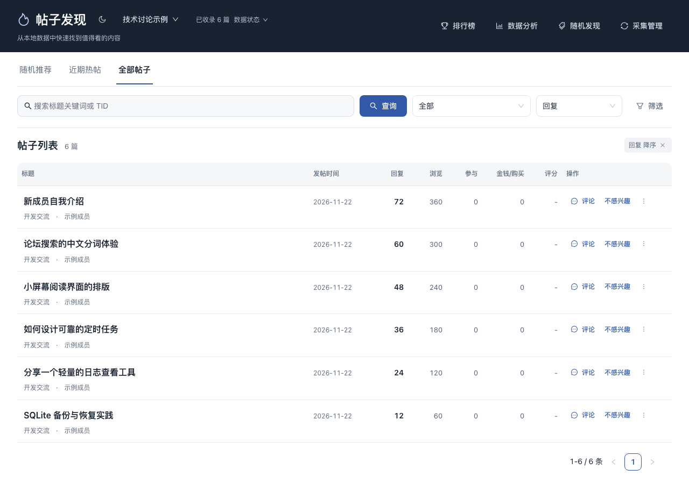

# 坛阅 TanYue

自托管的 Discuz! X3.5 采集与阅读工具。你可以在电脑上定时同步多个论坛，在手机上继续找未读热帖、查看评论或回看某一天的排行榜。每个论坛独立保存帖子、登录状态、阅读记录和定时任务。



## 从源码启动

先安装 Git、Python 3.13 和 Node.js 24（含 npm）。在终端运行：

```sh
git clone https://github.com/junmo-ops/tanyue.git
cd tanyue
npm --prefix frontend ci
npm --prefix frontend run build
python3 forum_api.py
```

Windows 上最后一行可用 `py -3.13 forum_api.py`。后端使用 Python 标准库。启动后打开 [本地阅读器](http://127.0.0.1:8000/)，按 Ctrl+C 停止服务。下次使用时，在项目目录直接运行启动命令即可。

## 接入第一个论坛

1. 点击「接入第一个论坛」，输入论坛安装目录，如 `https://forum.example.org/bbs/`。公共板块可以匿名读取；需要登录时使用该论坛属于自己的 Cookie。
2. 点击「识别板块」，勾选一个板块，用「预览」检查样本帖。
3. 接入后在「采集管理 → 新建采集」选择同步列表、指定板块和 **1 页**。任务完成后返回帖子列表，切换到「全部帖子」查看。
4. 如需自动采集，在「方案与定时」为当前站点建立定时任务。调度器随服务运行，电脑需保持唤醒。

## 手机访问

在 macOS 上启用私有网络免密访问后，运行 `python3 forum_api.py`，手机直接打开终端打印的地址即可。

| 手机连接方式 | 打开什么地址 |
| --- | --- |
| 和 Mac 在同一 Wi-Fi | 打开「同一局域网访问」地址。 |
| 使用 5G 或其他 Wi-Fi | 先在 Mac 上连接 Tailscale，再启动坛阅。手机连入同一 Tailscale 网络后，打开「Tailscale 访问」地址。 |

**首次启用**：在仓库根目录打开 `config.json`。如果文件还不存在，先复制一份 `config.example.json` 并命名为 `config.json`。在顶层的 `server` 对象中设置 `"private_network_access": true`（没有 `server` 时添加该对象），保存后重启坛阅。之后每次直接运行启动命令即可。

此模式下，同一私有局域网子网中的设备和通过 Tailscale 身份检查的设备均可读写站点，包括采集管理。新克隆的项目默认未启用此模式；使用默认配置时，局域网登录信息会显示在启动终端。只需本机访问时，可运行 `python3 forum_api.py --host 127.0.0.1`。

## 兼容范围

| 功能 | 如何确认 |
| --- | --- |
| 板块和列表 | 支持标准 Discuz 桌面模板的动态链接及常见伪静态链接。先用一个板块同步一页。 |
| 详情与评论 | 用「预览」读取样本帖。登录权限、模板及评论分页会影响可读范围。 |
| 排行榜 | 站点需开放对应排行。预览检查今日回复榜；完整采集按排行和周期记录结果。历史榜单来自本机采集的每日快照。 |

采集目标应是你有权读取的公共网络论坛。采集器限制并发、支持请求间隔，拒绝内网目的地址和跨源重定向。请遵守站点规则，合理设置抓取频率。

## 备份与开发

默认配置下，每个论坛的数据库位于 `data/sites/<站点ID>/forum.db`，同目录保存站点配置和 Cookie。旧版的 `data/forum.db.sites/` 会在下次启动时整体迁移到 `data/sites/`。

服务停止后备份整个 `data/` 目录，以及自行创建的 `config.json`。各站点的 `cookie.txt` 属于登录凭据，备份应按敏感数据保管。首次安装自动使用 `config.example.json`；需要自定义数据库路径时可复制为 `config.json`。

提交代码前，在项目根目录运行前端检查和后端测试：

```sh
npm --prefix frontend run lint
python3 -m unittest discover -s tests
```

代码采用 MIT 许可证，前端依赖的许可信息位于构建产物 `web/THIRD-PARTY.md`。反馈问题时请附提交编号、失败步骤和脱敏错误信息。
